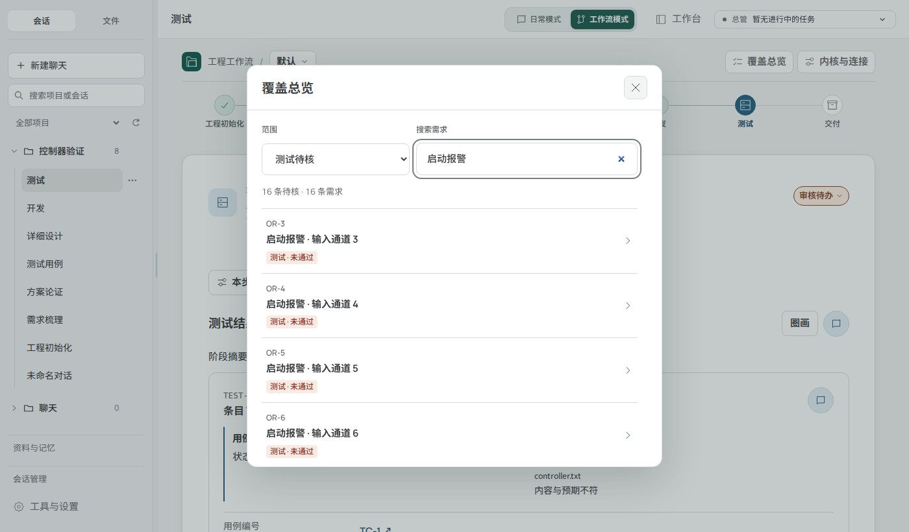
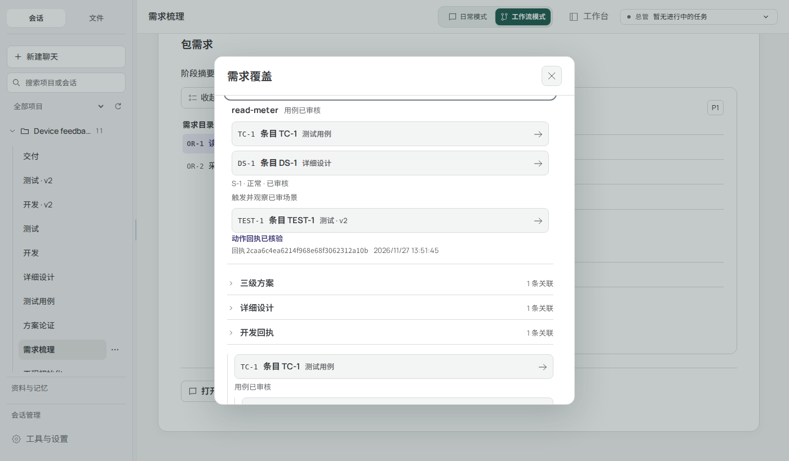
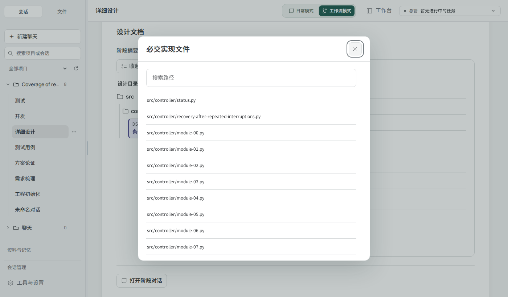

<p align="center">
  
</p>

# Cirven

Cirven 是面向工程项目的本地 AI 工作台。它把需求、方案、设计、开发和验收串在同一条工作流里，让工程师能沿需求编号回查设计依据、运行记录和验收证据。

## 工程工作流

默认流程依次包含工程初始化、需求梳理、方案论证、测试用例、详细设计、开发、测试、交付。用户可配置每个阶段的工具与连接，并在当前阶段审阅结果、批注或继续对话。覆盖总览可以沿需求编号定位遗漏与待核证据。



| 验收证据 | 设计文件 |
| --- | --- |
|  |  |

*截图来自包含合成工程数据的浏览器开发环境。*

## 从源码运行

准备 Python 3.10 和 Node.js 22.22.2。以下命令适用于 Linux 或 WSL，从仓库根目录执行。

```bash
python3.10 -m venv .venv
source .venv/bin/activate
python -m pip install -r requirements-source.txt
python scripts/prepare_source_checkout.py
npm --prefix apps/agent-shell ci
npm --prefix apps/agent-shell run build
python -m apps.api serve
```

打开 `http://127.0.0.1:8765/agent-shell/`。初次构建需要访问 GitHub、npm 和 PyPI。需要模型执行时，在工作台的「内核与连接」配置自己的 OpenCode 或 Claude Code 和模型服务。

- [开发、调试与验证](docs/DEVELOPMENT.md)
- [开发工具和依赖来源](docs/TOOLS.md)
- [工程工作流设计](docs/ENGINEERING_WORKFLOW_HARNESS.zh-CN.md)
- [第三方许可说明](NOTICE.md)

本仓库发布源码。原生桌面目标为 Windows x64，此次公开快照的构建验证范围记录在[开发文档](docs/DEVELOPMENT.md)。
